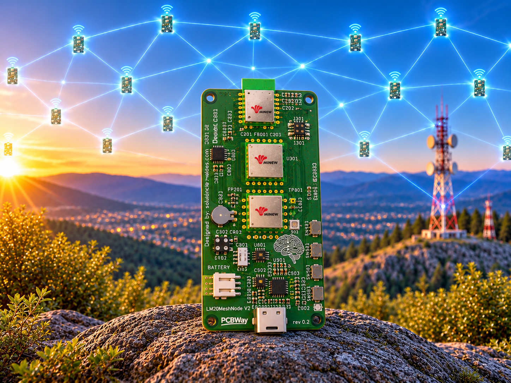
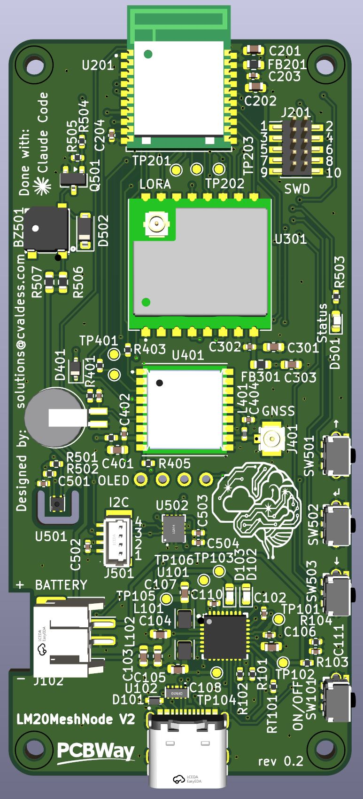
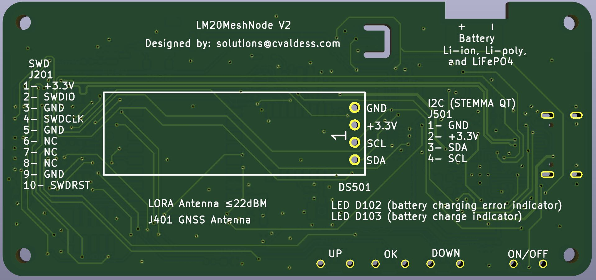
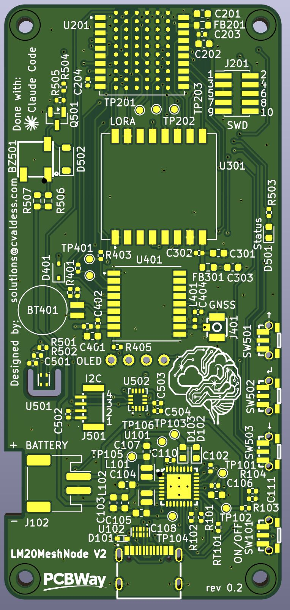

# LM20MeshNode

Pocket [Meshtastic](https://meshtastic.org/) node built around the Nordic **nRF54LM20A**
(Minew ME54BS13 module), with a Minew **MS21SF1** (SX1262) LoRa module, a Minew **ME31GR02**
GNSS receiver and a Nordic **nPM1300** PMIC for a single-cell LiPo battery. It connects to the
phone over Bluetooth LE.

| Front | Back |
|-------|------|
|  |  |

> **Status:** revision 0.2, not yet manufactured or tested. It replaces the Ebyte modules of
> revision 0.1 (E22-900MM22S and E108-GN04S) with Minew modules and adds a backup cell for the
> GNSS. Revision 0.1 is in the [LM20MeshNode](https://github.com/cvaldess/LM20MeshNode)
> repository. A Meshtastic firmware
> variant for revision 0.1 is under review as a draft: see [Meshtastic firmware](#meshtastic-firmware).

## Features

- **MCU:** Minew ME54BS13 (nRF54LM20A, Bluetooth LE with integrated antenna), USB-C to the
  nRF54LM20A USB port, 2×5 1.27 mm Cortex Debug (SWD) header (J201) and debug UART pads.
- **LoRa:** Minew MS21SF1-SX1262 (SX1262, up to 22 dBm). The antenna goes to the U.FL
  connector on the module itself. The RF switch inside the module is driven by DIO2, so the
  MCU drives no RXEN/TXEN line. The module supply has its own filter footprint: FB301 (0 Ω,
  or a ferrite bead) and C303.
- **GNSS:** Minew ME31GR02 (Beken BK166X chip) with U.FL antenna connector (J401). L401 (47 nH)
  feeds an active antenna from the module's VCC_RF output; a passive antenna also works if it
  is not a DC short. The GNSS supply (nPM1300 BUCK1) is off at power-up and is switched by
  firmware.
- **GNSS backup:** a rechargeable Seiko MS621FE coin cell (BT401) on V_BCKP, charged from
  3.3 V through a BAT54WS diode and 1 kΩ. It keeps the RTC and ephemeris data while the board
  is off, for faster fixes.
- **Power:** nPM1300 PMIC with USB-C input and ESD protection, 1S LiPo charger (JST PH 2.0,
  J102), on-board 10 kΩ NTC, 3.3 V main rail (BUCK2), power button (SW101) on SHPHLD, charge
  and error LEDs, and a battery voltage divider to an ADC input.
- **User interface:** 0.91" 128×32 OLED (SSD1306) on the back, three side buttons (UP, OK,
  DOWN), magnetic buzzer and a status LED.
- **Sensors:** Nyfea SHT41-P-NF temperature/humidity sensor (SHT41 compatible), thermally
  isolated by a slot, and an ST LSM6DS3TR-C IMU wired for wake-on-motion (INT1 on P0.02).
- **Expansion:** 4-pin 1 mm I²C connector (J501, Qwiic-style pinout: GND, 3.3 V, SDA, SCL).
- **Board:** 4 layers (signal / GND / 3.3 V / signal), 40 × 85.68 mm, 1.6 mm, M2 mounting
  holes. All SMD parts are on the top side.

## nRF54LM20A pin map

| Function | Pin | Notes |
|----------|-----|-------|
| LoRa SPI (SPIM22): SCK, MOSI, MISO, NSS | P1.17, P1.16, P1.15, P1.18 | |
| LoRa BUSY, DIO1, NRST | P1.19, P1.23, P1.26 | RF switch driven by DIO2 inside the module |
| I²C (TWIM30): SDA, SCL | P0.03, P0.04 | 4.7 kΩ pull-ups |
| GNSS UART (UARTE20): MCU TX → GNSS RXD, GNSS TXD → MCU RX | P1.03, P1.29 | 1 kΩ series resistors; test pads TP402 (GNSS RXD) and TP401 (GNSS TXD) |
| GNSS PPS | P1.04 | |
| GNSS reset | P1.00 | Only through R405 (0 Ω, not fitted). The ME31GR02 reset has an internal pull-up |
| GNSS power enable | P1.05 | To nPM1300 GPIO0 |
| PMIC interrupt | P1.06 | From nPM1300 GPIO1 |
| Battery voltage (divider 2 × 1 MΩ) | P1.30 (AIN2) | |
| Buttons UP, OK, DOWN | P1.27, P1.28, P1.25 | |
| Buzzer (PWM) | P1.09 | |
| Status LED | P2.00 | |
| IMU INT1, INT2 | P0.02, P0.05 | P0 can wake the chip from System OFF |
| Debug UART (UARTE00): TX, RX | P2.02, P2.07 | Test pads |

P1.12 and P1.13 (LoRa TXEN and RXEN in revision 0.1) are free.

I²C devices: nPM1300 `0x6B`, LSM6DS3TR-C `0x6A`, SHT41 `0x44`, OLED `0x3C`.

### Firmware notes

- The nPM1300 starts with the **battery charger disabled**. Firmware must enable charging
  over I²C. The board is designed so that LoRa and Bluetooth work without a PMIC driver.
- The MS21SF1 has a crystal, not a TCXO: do not define a DIO3 TCXO voltage. Use DIO2 as the RF
  switch and define no RXEN/TXEN pins.
- The GNSS rail (BUCK1) must be set to 3.3 V and enabled by firmware.
- The ME31GR02 uses a Beken BK166X chip, which Meshtastic does not detect yet. It talks NMEA at
  115200 bps by default, prints `$POLRS` or `$BKCHIP` at start-up and is configured with
  `$POLCFG…` commands.
- While the GNSS is unpowered or running from the backup cell, no MCU pin connected to it may
  be driven high: put the UART TX pin in input mode with a pull-down. This is why R405 (reset)
  is not fitted.

## Meshtastic firmware

The `lm20meshnode` variant is under review upstream. It was written for **revision 0.1**
(Ebyte modules). All three pull requests are open, and nothing has run on hardware yet:

| Part | Pull request |
|------|--------------|
| Meshtastic variant (draft, on top of the nRF54LM20-DK support in [#12130](https://github.com/meshtastic/firmware/pull/12130)) | [meshtastic/firmware#12354](https://github.com/meshtastic/firmware/pull/12354) |
| Arduino core variant | [andyshinn/nRF54_Arduino#3](https://github.com/andyshinn/nRF54_Arduino/pull/3) |
| Bootloader board | [andyshinn/nRF54_Bootloader#3](https://github.com/andyshinn/nRF54_Bootloader/pull/3) |

Until they are merged, the variant builds from the `feat/lm20meshnode-variant` branch of
[cvaldess/firmware](https://github.com/cvaldess/firmware/tree/feat/lm20meshnode-variant) with
`pio run -e lm20meshnode`. The core and the bootloader come from forks (the core at a pinned commit,
the bootloader at the tag `v0.5.0-lm20meshnode.1`).

What the variant does on revision 0.1:

- **nPM1300**, set up over I²C at boot: BUCK1 (GNSS rail) at 3.3 V, switched by the PMIC's GPIO0,
  which the GPS code drives from P1.05; battery charger on at 200 mA (`NPM1300_CHARGE_CURRENT_MA`),
  4.20 V (4.00 V in the warm region), with the on-board 10 kΩ NTC; USB input limit 500 mA. BUCK2,
  the 3.3 V main rail, is left on its VSET2 setting. After USB is unplugged and plugged in again,
  the PMIC goes back to its 100 mA startup input limit until the next boot.
- **LoRa** with RXEN from the MCU and TXEN from DIO2, no TCXO. **GNSS** on `Serial1` at 38400 bps.
- **Buttons:** UP, DOWN and OK navigate the screen (up/down input driver). **OLED** at 128×32,
  **buzzer**, **status LED**, **battery** level from AIN2, and the SHT41 and LSM6DS3TR-C drivers.
- **USB-C:** console and Meshtastic API over USB CDC; firmware updates over USB (serial DFU or a
  UF2 drive) or over Bluetooth.
- **Bootloader** (64 KB, application at `0x10000`): hold **OK** at reset for USB DFU (UF2 drive
  `LM20MN-BOOT`), **OK + DOWN** for Bluetooth OTA. The status LED shows the bootloader state.

Revision 0.2 needs these changes in the variant: DIO2 as the RF switch and no RXEN pin (LoRa),
a detection probe for the Beken GNSS at 115200 bps, the GNSS UART TX pin left as an input with a
pull-down while the GNSS is off, and no GNSS reset pin.

Not tested yet, besides the board itself: the nPM1300 setup, GPS on the nRF54 platform (no other
nRF54 variant uses it so far), the 128×32 screen layout and the battery reading through the
2 × 1 MΩ divider.

## Manufacturing

The [`fab/pcbway/`](fab/pcbway/) folder contains:

- `nrflm20-meshnode_rev0.2_pcbway.zip`: Gerber files (4 copper layers, masks, top paste,
  silkscreen, outline), Excellon drill files (PTH and NPTH) and an IPC-D-356 netlist.
- `gerber/`: the same files unzipped, plus drill maps and the drill report.
- `nrflm20-meshnode-BOM-PCBWay.csv`: bill of materials (40 lines, 70 parts) with manufacturer part
  numbers and LCSC codes. A few passives are generic parts, listed by specification.
- `nrflm20-meshnode-CPL-PCBWay.csv`: component placement (centroid) file in millimetres, in the
  same coordinate system as the Gerber files. The OLED (DS501) is the only part on the bottom side.
- `pedido_pcbway.txt`: order settings and pre-production checks (in Spanish).

Not fitted (DNP) and left out of the BOM and placement files: R404, R405. Mounting holes and
test points are not parts and are left out too.

**BT401 is soldered by hand.** The MS621FE-FL11E coin cell must not go through reflow (Seiko:
soldering iron, 5 s maximum, cell below 85 °C), so it is left out of the BOM and placement
files. Its pads do get paste in the stencil, which tins them during reflow; solder the cell
last.

Board: 4 layers, 1.6 mm, 1 oz copper, ENIG recommended, minimum track/space 0.2 mm, minimum
drill 0.3 mm. Stencil: top side only, 0.10 mm, needed by the 0.5 mm pitch parts. Minew
recommends thicker paste on its modules (0.13–0.2 mm); with 0.10 mm, check the castellated
pads after reflow and touch them up with a soldering iron if needed. The standard PCBWay
4-layer stackup is fine; impedance control is not needed (the only RF track on the board, from
J401 to the GNSS module, is 3.9 mm long).

The files are generated from the saved board with `docs/gen/fab_pcbway.py` (Gerber, drill,
IPC-D-356) and `docs/gen/bom_cpl_pcbway.py` (BOM and placement), using KiCad's Python.

## Design files

- [KiCad 10](https://www.kicad.org/) project: `nrflm20-meshnode.kicad_pro`. The root schematic
  has five sheets: power, MCU, LoRa, GNSS and interface.
- `libs/`: project symbols, footprints and 3D models. The MS21SF1 and ME31GR02 footprints were
  converted from Minew's design files (`docs/gen/huellas_minew.py`). The ME54BS13 3D model was
  drawn from its datasheet (`docs/gen/modelo3d_me54bs13.py`).
- **3D models of the MS21SF1 and ME31GR02 are not included yet**: they are Minew's files and are
  waiting for Minew's permission to publish them. The footprints already point to
  `libs/meshnode.3dshapes/MS21SF1_PCB_V1.0.step` and `libs/meshnode.3dshapes/GNSS_MODULE_1010.step`,
  so a clone of this repository renders the board without those two modules.
- `docs/`: block diagram and schematic drafts (SVG). `docs/gen/` has the Python scripts used
  during the design.
- `lista_compra.txt`: shopping list (in Spanish).

Some footprints and 3D models come from [easyeda2kicad](https://github.com/uPesy/easyeda2kicad.py)
(`${EASYEDA2KICAD}`). The footprints are stored in the board file, but their 3D models are
not included in this repository.

## Credits

- **Designed by:** solutions@cvaldess.com
- **Made with:** [Claude Code](https://claude.com/claude-code), [KiCad](https://www.kicad.org/)
  and [Konnect-EDA](https://github.com/Orchis-ai-LLC/Konnect-EDA)
- **Sponsors:** [PCBWay](https://www.pcbway.com/) and [MinewSemi](https://www.minewsemi.com/)
  (ME54BS13, MS21SF1 and ME31GR02 modules)

## License

Copyright © 2026 CValdesS.

This source describes Open Hardware and is licensed under the CERN-OHL-S v2
([LICENSE](LICENSE)). You may redistribute and modify this source and make products using it
under the terms of the CERN-OHL-S v2. This source is distributed WITHOUT ANY EXPRESS OR IMPLIED
WARRANTY, INCLUDING OF MERCHANTABILITY, SATISFACTORY QUALITY AND FITNESS FOR A PARTICULAR
PURPOSE. Please see the CERN-OHL-S v2 for applicable conditions.

Source location: https://github.com/cvaldess/LM20MeshNodeV2
